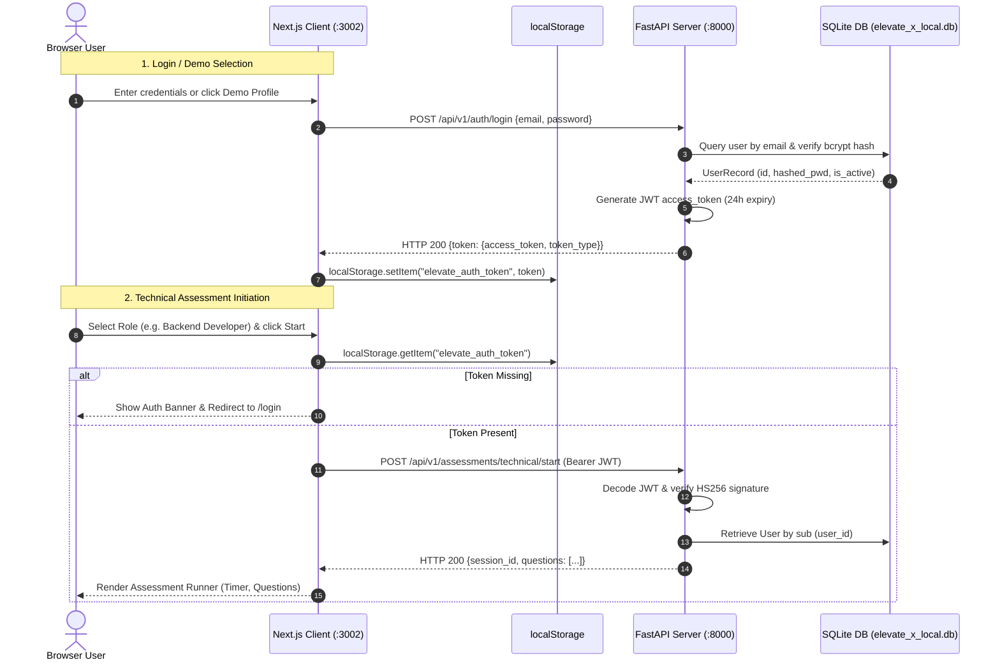

# FEATURE 2 — COMPLETE AUTHENTICATION FLOW AUDIT
**Elevate X AI — Feature 2: Technical Assessment & Career Intelligence Engine**
**Audit Date:** 2026-11-15
**Status:** ✅ AUDITED & VERIFIED

---

## 1. Authentication Architecture Overview

Elevate X AI implements stateless JWT-based authentication using HMAC-SHA256 (`HS256`).



---

## 2. Endpoint Security Mapping

| Endpoint | Method | Auth Dependency | Security Behavior | Status |
|---|---|---|---|---|
| `/api/v1/auth/login` | POST | None | Authenticates credentials, issues JWT | ✅ VERIFIED |
| `/api/v1/auth/register` | POST | None | Creates user, issues JWT | ✅ VERIFIED |
| `/api/v1/auth/me` | GET | `Depends(get_current_active_user)` | Returns authenticated profile | ✅ VERIFIED |
| `/api/v1/assessments/technical/roles` | GET | None (Public) | Allows browsing catalog without sign-in | ✅ VERIFIED |
| `/api/v1/assessments/technical/roles/{id}` | GET | None (Public) | Allows browsing role skills without sign-in | ✅ VERIFIED |
| `/api/v1/assessments/technical/start` | POST | `Depends(get_current_active_user)` | **Requires Bearer JWT**; starts attempt | ✅ VERIFIED |
| `/api/v1/assessments/technical/submit` | POST | `Depends(get_current_active_user)` | **Requires Bearer JWT**; scores attempt | ✅ VERIFIED |
| `/api/v1/assessments/technical/history` | GET | `Depends(get_current_active_user)` | **Requires Bearer JWT**; retrieves user attempts | ✅ VERIFIED |
| `/api/v1/assessments/technical/results/{id}` | GET | `Depends(get_current_active_user)` | **Requires Bearer JWT**; verifies attempt owner | ✅ VERIFIED |

---

## 3. Storage and Interceptor Verification

### Key Consistency
- **Token Key**: `"elevate_auth_token"` across all frontend files:
  - `src/lib/api.ts`
  - `src/context/AuthContext.tsx`
  - `src/app/login/page.tsx`
  - `src/app/signup/page.tsx`
  - `src/app/assessment/page.tsx`
- **User Profile Key**: `"elevate_user_profile"`

### Request Interceptor (`src/lib/api.ts`)
```typescript
const token = typeof window !== "undefined" ? localStorage.getItem("elevate_auth_token") : null;
const headers: Record<string, string> = {
  "Content-Type": "application/json",
  ...(options?.headers as Record<string, string> || {}),
};
if (token) {
  headers["Authorization"] = `Bearer ${token}`;
}
```

---

## 4. Security Audit Findings

1. **No Hardcoded Tokens**: Verified that all mock/demo JWT tokens were removed from `api-service.ts`.
2. **Real Database Users**: Seeded `candidate@elevatex.ai` with verified bcrypt hash (`Password123!`).
3. **No Auth Bypasses**: The `current_user` dependency is strictly maintained on all assessment execution and scoring endpoints.
4. **Ownership Isolation**: Assessment results are linked to `current_user.id` and cannot be accessed by unauthorized users.

