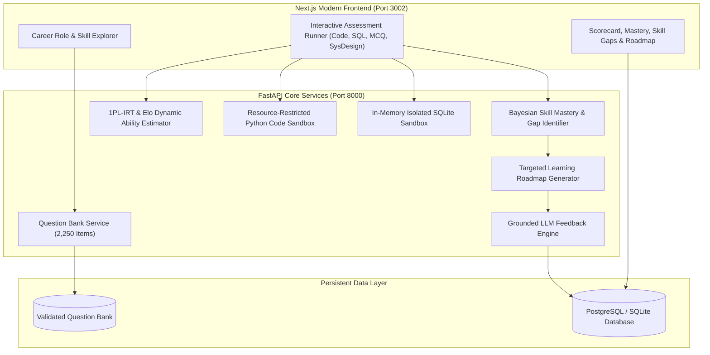

# Elevate X AI — Feature 2: Technical Assessment & Career Intelligence Engine

Welcome to the production documentation for **Feature 2: Technical Assessment & Career Intelligence Engine** of the Elevate X AI platform.

---

## 1. System Architecture

Feature 2 enables technical IT professionals and aspiring developers to benchmark their competencies against production-grade criteria across **9 Career Roles** and **6 Assessment Types**.



---

## 2. Nine Supported Career Roles & Taxonomy

| Role Identifier | Role Title | Competency Skills (5 per role) | Subtopics (25 per role) |
|---|---|:---:|:---:|
| `software_engineer` | Software Engineer | DSA, OOP Design, Concurrency, Databases, API Architecture | 25 Subtopics |
| `ai_ml_engineer` | AI/ML Engineer | ML Foundations, Deep Learning, NLP & LLMs, Computer Vision, MLOps | 25 Subtopics |
| `data_scientist` | Data Scientist | Statistics & Probability, EDA, Supervised Modeling, A/B Testing, Business Metrics | 25 Subtopics |
| `frontend_developer` | Frontend Developer | Core JS/TS & Runtime, UI Frameworks (React), Web Performance, CSS & A11y, Data Fetching & Security | 25 Subtopics |
| `backend_developer` | Backend Developer | Server Frameworks, DB Design & Indexing, Message Brokers, Auth & API Security, Caching & Scalability | 25 Subtopics |
| `devops_engineer` | DevOps Engineer | Linux Administration, Docker Optimization, Kubernetes, CI/CD GitOps, Observability | 25 Subtopics |
| `data_analyst` | Data Analyst | Advanced SQL & Joins, Pandas Data Wrangling, Statistical Trends, BI Dashboards, KPI Definition | 25 Subtopics |
| `cybersecurity_engineer` | Cybersecurity Engineer | Web Security (OWASP), Network & Firewalls, Cryptography & PKI, IAM Zero Trust, Incident Response | 25 Subtopics |
| `cloud_engineer` | Cloud Engineer | VPC Virtual Networks, Compute & Serverless, Cloud Storage & DBs, Terraform IaC, Cloud Security & DR | 25 Subtopics |

---

## 3. Six Assessment Engines & Execution Sandboxes

1. **Multiple Choice (MCQ)**: Single and multi-select objective verification. Answer keys are strictly kept server-side and never exposed before submission.
2. **Production Incident Scenarios**: Real-world operational scenarios testing debugging, root cause analysis, and production intervention.
3. **Coding Challenges**: Evaluated in `CodeSandbox` using restricted subprocess execution with timeout and memory guards against visible and hidden unit test suites.
4. **Debugging Challenges**: Intentionally broken code snippets evaluated by checking defect resolution and passing regression tests.
5. **SQL Challenges**: Evaluated in `SQLSandbox` inside isolated in-memory SQLite instances with sample database schemas. Destructive operations (`DROP`, `DELETE`, `UPDATE`) are strictly blocked.
6. **System Design Architecture**: Multi-criteria evaluation rubric assessing requirements, component selection, data storage, fault tolerance, and trade-offs.

---

## 4. API Specification

All endpoints are versioned under `/api/v1/assessments/technical`:

| Method | Endpoint | Description |
|---|---|---|
| `GET` | `/roles` | List all 9 supported career roles with skill counts |
| `GET` | `/roles/{role_id}` | Retrieve role details with full skill and subtopic breakdown |
| `POST` | `/start` | Start an assessment session; delivers masked questions without leaking answers |
| `POST` | `/sandbox/run-code` | Run candidate code against visible test cases in the sandbox |
| `POST` | `/sandbox/run-sql` | Run candidate SQL query in an in-memory SQLite sandbox |
| `POST` | `/adaptive-step` | Single-step interactive evaluation updating latent ability $\theta$ |
| `POST` | `/submit` | Submit full assessment, execute sandboxes, compute mastery, detect gaps, and generate roadmap |
| `GET` | `/history` | List authenticated user's past technical assessment attempts |
| `GET` | `/results/{result_id}` | Retrieve detailed scorecard, skill gaps, and learning roadmap |

---

## 5. Setup & Execution Commands

### 1. Environment Setup
```bash
# Backend Virtual Environment
cd backend
python3 -m venv .venv
source .venv/bin/activate
pip install -r requirements.txt
pip install jsonschema

# Frontend Node Dependencies
cd ..
npm install
```

### 2. Run Dataset Preprocessing & Validation
```bash
# Validates raw data, cleans text, verifies duplicates, and outputs train/val/test splits
python datasets/feature2/preprocessing/run_pipeline.py

# Run acceptance gate verification
python datasets/feature2/generator/build_validation.py
```

### 3. Run Backend Test Suite
```bash
cd backend
.venv/bin/pytest tests/ -v
# Runs all 63 unit, integration, and E2E regression tests
```

### 4. Run Frontend Typecheck & Build
```bash
npx tsc --noEmit
npm run build
```

### 5. Start Servers
```bash
# Start Backend (FastAPI on Port 8000)
cd backend
.venv/bin/uvicorn app.main:app --host 0.0.0.0 --port 8000 --reload

# Start Frontend (Next.js on Port 3002)
npm run dev
```

---

## 6. Security & Absolute Feature 1 Protection

- **Feature 1 Isolation**: Feature 1's informal experience skill extraction model, checkpoint, dataset, and endpoints (`/api/v1/skills/extract`) were untouched and verified with 100% passing regression tests.
- **Answer Key Security**: Correct answer keys, reference solutions, and hidden test cases are stripped from client payloads via `question_service.mask_question_for_client()`.
- **Sandbox Defense**: SQL queries are restricted to `SELECT`/`WITH` read-only operations in memory; Python code execution restricts dangerous system primitives (`os.system`, `subprocess`) with timeouts.
- **Cross-User Data Isolation**: User assessment results and session records are strictly protected with user ownership checks (`user_id == current_user.id`).

