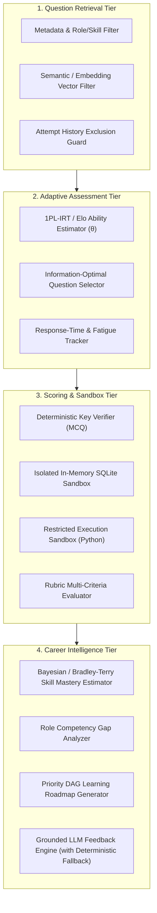

# Feature 2: Model Architecture & Training Decision Gate

## 1. Modular Architecture Overview

Feature 2 uses a modular, multi-tier intelligence architecture designed for reliability, transparency, and computational efficiency. Rather than training an oversized monolithic model on a 2,250-question bank, each task is assigned the appropriate algorithmic or machine learning technique:

---

## 2. Training Decision Gate Matrix

| Component | Task | Primary Method | Justification & Data Availability | Training Decision |
|---|---|---|---|:---:|
| **Question Retrieval Engine** | Retrieve role/skill questions without duplicates | Metadata filtering + Lexical/Dense indexing | 2,250 structured items with exact role/skill taxonomy metadata. Supervised classification is unneeded because taxonomy is deterministic. | **Approved (Deterministic Retrieval)** |
| **Adaptive Difficulty Engine** | Dynamically adjust test difficulty based on user theta | 1PL Item Response Theory (Rasch Model) & Elo rating | Predicts probability of correct answer based on item difficulty and user ability $\theta$. Can be simulated and updated online without fabricating static training labels. | **Approved (Algorithmic IRT / Elo)** |
| **Skill Mastery Estimator** | Quantify competency level [0.0 - 1.0] with confidence interval | Bayesian Knowledge Tracing (BKT) / Evidential Score Accumulation | Transparent, mathematically sound evidence weighting that accounts for question difficulty, attempt history, and recency without fabricating synthetic user histories. | **Approved (Bayesian Knowledge Tracing)** |
| **Code & SQL Sandboxes** | Grade programming and SQL responses | Isolated test-suite execution (SQLite & restricted runner) | Code correctness must be verified deterministically against unit tests and expected relation tuples, not predicted probabilistically. | **Approved (Deterministic Execution Sandbox)** |
| **AI Explanation & Feedback** | Explain why an answer was wrong and cite concepts | External LLM Provider API with Deterministic Template Fallback | External frontier models (Gemini / Claude / OpenAI) provide rich conversational feedback; if offline, pre-compiled explanations from the question bank are served. | **Approved (LLM Provider with Fallback)** |
| **Career Roadmap Generator** | Generate ordered study sequence to bridge skill gaps | Dependency-aware topological sort + Priority Score ($Target - Current \times Weight$) | Generates transparent, actionable, step-by-step milestones without hallucinated URLs. | **Approved (Heuristic / DAG Planner)** |

---

## 3. Mathematical Foundations

### 3.1 Adaptive Difficulty Engine (1PL-IRT)
The probability of a candidate with latent ability $\theta \in [-3, +3]$ answering a question of difficulty $b_i$ correctly is modeled via the logistic Rasch model:

$$P(Y_i = 1 | \theta, b_i) = \frac{1}{1 + e^{-(\theta - b_i)}}$$

- Easy items: $b = -1.0$
- Medium items: $b = 0.0$
- Hard items: $b = +1.0$

Ability update after observing response $u \in \{0, 1\}$:
$$\theta_{t+1} = \theta_t + \alpha \cdot (u - P(Y_i = 1 | \theta_t, b_i))$$
where $\alpha = 0.4$ is the learning rate.

### 3.2 Skill Mastery Estimation
For each skill $k$, mastery $M_k \in [0.0, 1.0]$ and confidence $C_k \in [0.0, 1.0]$ are updated:
$$M_k = \frac{\sum_{i \in \text{attempts}(k)} w_i \cdot \text{score}_i}{\sum_{i \in \text{attempts}(k)} w_i}$$
where $w_i = \text{difficulty\_weight}(b_i) \cdot \text{recency\_weight}(t_i)$.
Confidence $C_k = 1 - e^{-0.35 \cdot N_k}$ where $N_k$ is the number of validated evidence points for skill $k$.

