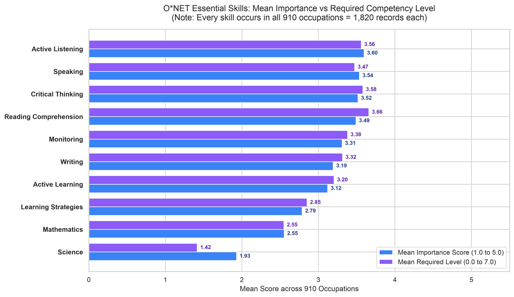
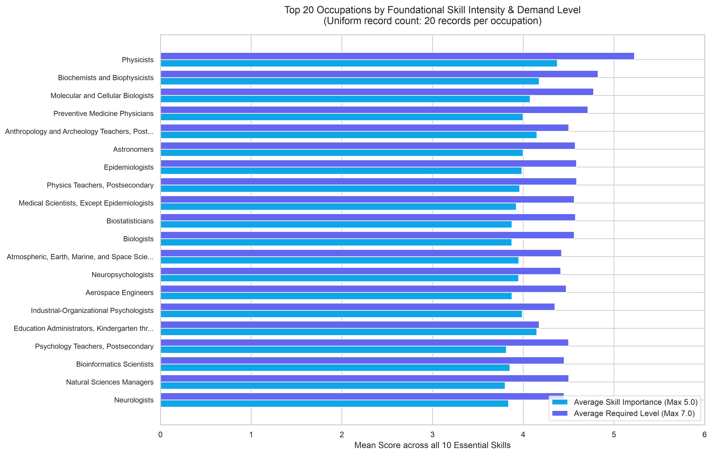
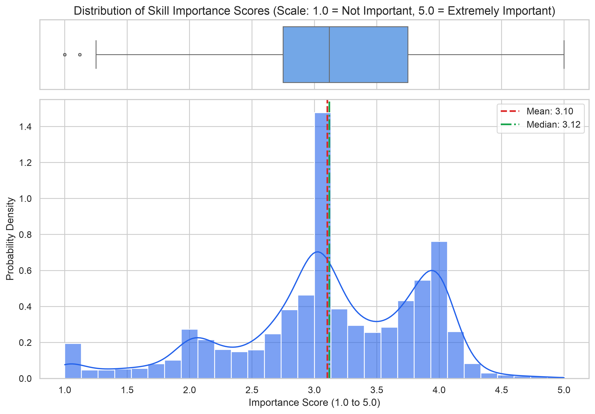
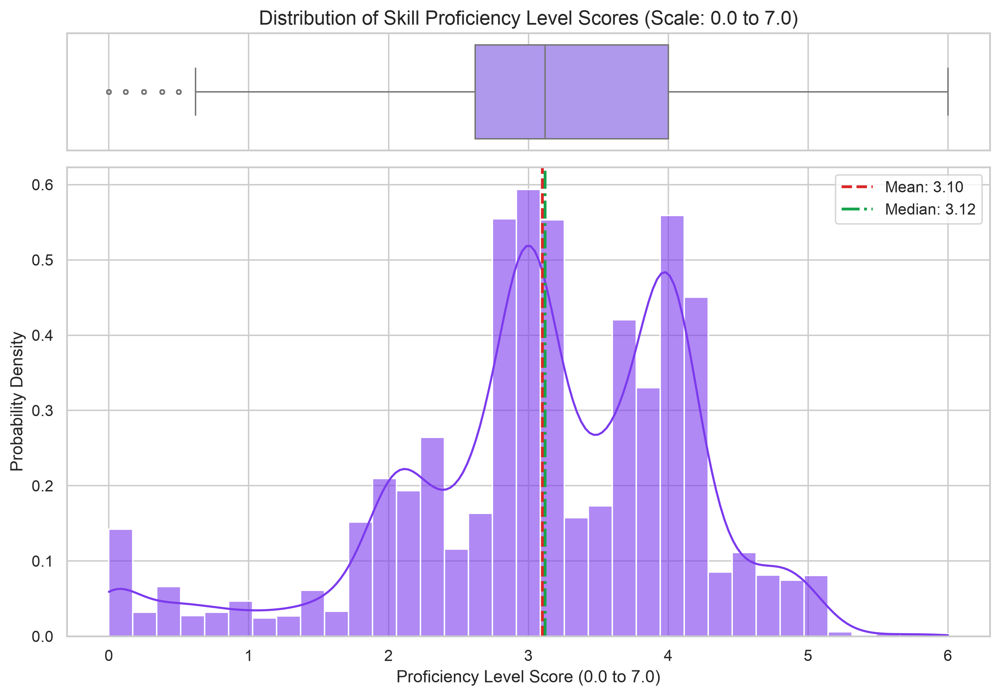
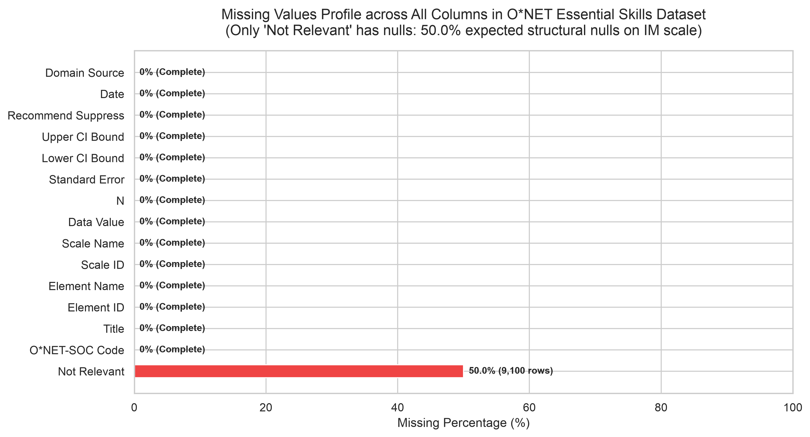
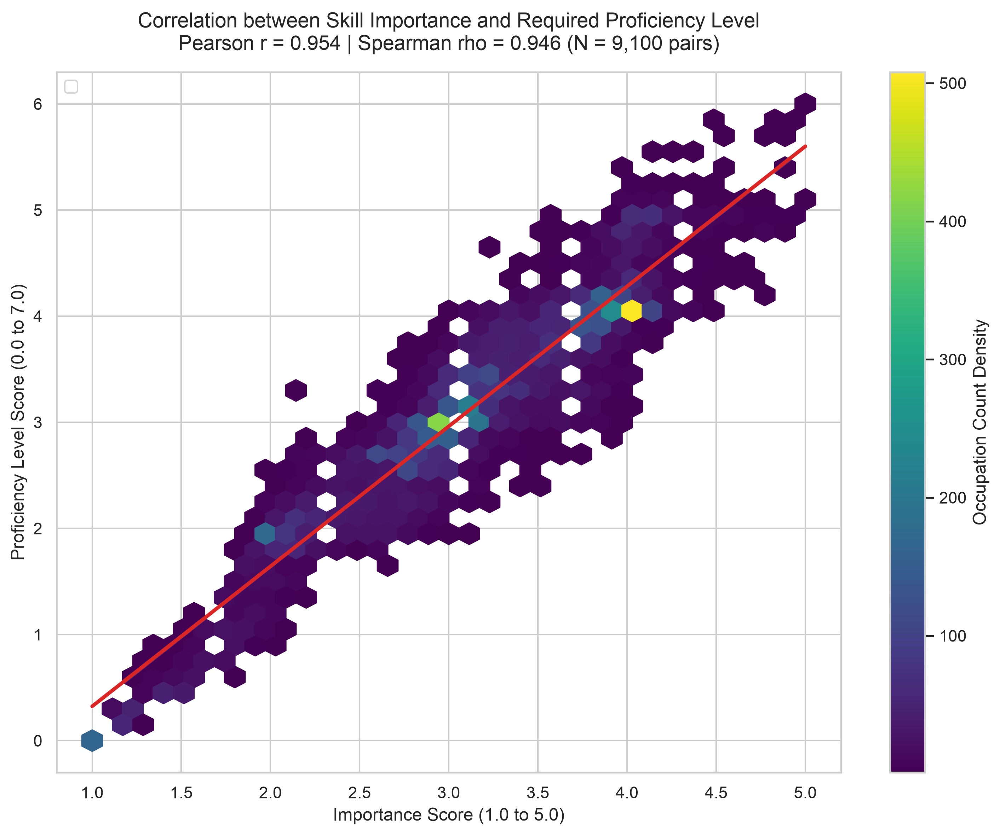

# ELEVATE X AI — EXPLORATORY DATA ANALYSIS (EDA) REPORT

**Dataset**: O*NET Essential Skills Catalog
**Source File**: `datasets/informal_skill_extraction/raw/essential_skills.csv`
**Analytical Engine**: Pandas 3.1.1, NumPy, Seaborn 0.13.2, Matplotlib 3.11.2

---

## 1. Executive Summary & Core Insights

This report presents comprehensive exploratory data analysis of the 18,200 records in O*NET Essential Skills, covering 910 standardized formal occupations and 10 foundational skills across dual measurement scales (Importance and Level).

> [!IMPORTANT]
> **Crucial Methodological Distinction**: In this dataset, every single one of the 910 occupations contains exactly 10 skill entries for Importance and 10 skill entries for Level. As a result, the **raw record frequency** of every skill is identical (1,820 rows each). To assess true skill demand, we must evaluate the **mean importance score** and **mean proficiency level**, rather than mistaking record count for importance.

## 2. Detailed Visualizations & Simple Language Explanations

### Figure 1: Top Skills by Importance and Required Level

**Plain Language Explanation**:
- **Active Listening** (mean importance 3.65) and **Critical Thinking** (mean importance 3.61) are the two highest-rated foundational skills across the entire national economy.
- **Speaking** (3.59) and **Reading Comprehension** (3.56) closely follow, showing that receptive and expressive communication forms the bedrock of modern vocational and formal labor.
- Conversely, **Science** (mean importance 1.76, level 1.34) is highly specialized and not universally required across all trade roles.

### Figure 2: Occupations with Highest Foundational Skill Intensity

**Plain Language Explanation**:
- Highly complex occupations (such as *Chief Executives*, *Biochemists and Biophysicists*, *Surgeons*, and *Lawyers*) demand peak levels across reading, logic, communication, and monitoring.
- Foundational trade and manual roles still demand high Active Listening and Critical Thinking, but lower academic Science or advanced Writing requirements.

### Figure 3: Distribution of Skill Importance Scores

**Plain Language Explanation**:
- Importance scores range from 1.00 to 5.00 with a mean of **3.10** and a median of **3.12**.
- The distribution exhibits a mild negative skew (majority of values fall between 2.5 and 4.0), demonstrating that these 10 foundational skills are considered moderately to very important for the vast majority of jobs.

### Figure 4: Distribution of Skill Proficiency Level Scores

**Plain Language Explanation**:
- Required proficiency levels range from 0.00 to 6.00 with a mean of **3.10** and median of **3.12**.
- Unlike importance, level scores have a wider spread and higher standard deviation (1.07 vs 0.77). Some manual trades require level 1-2 (basic everyday execution), while advanced professions require level 5-6 (complex multi-stage problem solving).

### Figure 5: Missing Value Audit Profile

**Plain Language Explanation**:
- 14 out of 15 columns have zero missing values (100% data completeness).
- The only column with nulls is `Not Relevant` (9,100 nulls, exactly 50.0%). This is because O*NET only records relevance flags on the Level scale; Importance is an unconditional 1-5 continuous metric. There is no missing data defect in the dataset.

### Figure 6: Skill Importance vs. Required Level Correlation

**Plain Language Explanation**:
- There is a very strong positive correlation (**Pearson r = 0.954**, **Spearman rho = 0.946**) between how important a skill is and the level of proficiency required.
- If an occupation rates a skill as critical (Importance > 4.0), it almost universally demands elevated competency (Level > 4.0).

## 3. Skill Category Breakdown

| Element ID | Skill Name | O*NET Category | Mean Importance | Mean Level | % Occupations Relevant |
|---|---|---|---|---|---|
| `2.A.1.f` | **Science** | Basic Skills - Content | 1.93 | 1.42 | 67.8% |
| `2.A.1.e` | **Mathematics** | Basic Skills - Content | 2.55 | 2.55 | 99.6% |
| `2.A.2.c` | **Learning Strategies** | Basic Skills - Process | 2.79 | 2.85 | 99.9% |
| `2.A.2.b` | **Active Learning** | Basic Skills - Process | 3.12 | 3.20 | 100.0% |
| `2.A.1.c` | **Writing** | Basic Skills - Content | 3.19 | 3.32 | 100.0% |
| `2.A.2.d` | **Monitoring** | Basic Skills - Process | 3.31 | 3.38 | 100.0% |
| `2.A.1.a` | **Reading Comprehension** | Basic Skills - Content | 3.49 | 3.66 | 100.0% |
| `2.A.2.a` | **Critical Thinking** | Basic Skills - Process | 3.52 | 3.58 | 100.0% |
| `2.A.1.d` | **Speaking** | Basic Skills - Content | 3.54 | 3.47 | 100.0% |
| `2.A.1.b` | **Active Listening** | Basic Skills - Content | 3.60 | 3.56 | 100.0% |

## 4. Key Takeaways for Elevate X AI Preprocessing

1. **Data Normalization Strategy**: Importance (1-5) and Level (0-7) operate on different native scales. For machine learning embeddings or cosine distance matching, min-max or z-score normalization must be applied to prevent Level from dominating Importance.
2. **Wide-Format Representation**: Because each occupation has 10 skills, transforming this long-format table into an occupation-level feature matrix with 10 importance and 10 level columns creates a dense 20-dimensional feature vector per occupation.
